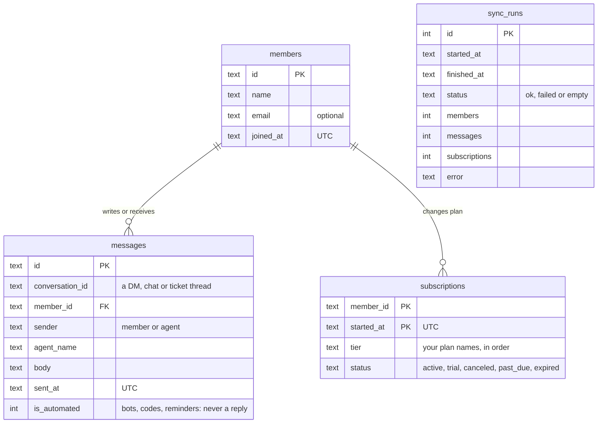

# Customer Support Analytics

[](https://github.com/accnadashaban-png/customer-support-analytics/actions/workflows/ci.yml)
   

Support analytics for any community, helpdesk or chat team: **who is still waiting for an answer, how fast your team really replies in business hours, whether you meet your SLA, what people ask about, and who upgraded after talking to support.** Connect **your own data as it is**: any chat or helpdesk export through a column-mapping file, your own database through a read-only connection, or a website chat and DMs live through a webhook.


**Demo business: Wasla**, a fictional home-internet provider: 5,000 customers, 12 months, 8 agents answering WhatsApp, web chat and email in one inbox, about 5,800 conversations and 16,000 messages in Arabic (Egyptian, Gulf, Levantine, Maghrebi, MSA), English and Franco, with bots, greetings, broadcasts, returning customers and plan changes (Free prepaid, Basic, Pro, Elite). Swap in your own data and topics; nothing in the code is specific to Wasla.

> A public, from-scratch rebuild of the kind of internal tool I helped build at work, running here on **synthetic data**. No company data, names or integrations.

## What it answers

| Question | How |
|---|---|
| Who is waiting for us right now? | An **open queue**, oldest first, with waiting time in business hours and alerts past a threshold. |
| How fast do we reply, honestly? | First response to each **contact**, in calendar and **business** minutes (team time zone, working days, holidays). Bots never count as a reply. |
| Do we meet our SLA? | Share of contacts answered within the target, and every breach, including unanswered ones. |
| What do people ask about? | **Topics scored over the whole conversation** (Arabic dialects, English, Franco, spelling variants), with a confidence, and **"uncertain" instead of a guess**. Measured on hand-labeled conversations: **90.9% accuracy on the unseen half**, 100% precision on 6 of 7 topics. Per-topic reply rate, speed and SLA. |
| Does support drive revenue? | Upgrades within 14 days of a contact, the **monthly revenue** they added, and a contacted → replied → within SLA → upgraded **funnel**. |
| Who on the team carries the load? | Per-agent first replies, speed and SLA. |

## Why the numbers can be trusted, and are fair

Raw exports make support look better or worse than it is. The rules are explicit ([METRICS.md](docs/METRICS.md)) and **evaluated**:

- **14 exact scenarios** (79 checks), one rule each, computed by hand: a bot code 30 seconds after the member writes,
  Thursday-evening-to-Sunday replies (63 h on the clock, 20 business minutes), holidays, a team in another time zone,
  a returning member starting a second contact, a lone "thanks", trials, downgrades, cancellations, late upgrades, offsets in input timestamps.
- **Invariants on 25 random datasets**: business time never exceeds calendar time, a met SLA is within target,
  upgrades are inside the window and go up a plan, re-importing the same data changes nothing.
- The evaluator is tested too: a deliberately wrong expectation must fail.
- **Fair to people:** off-hours time is never counted against the team, bots never count as replies, and agents or topics with fewer than 10 contacts are marked as too few to compare. See [Fairness](docs/METRICS.md#fairness).

```bash
python -m support_analytics eval     # scenarios 14/14 (79 checks), invariants 25/25
```

## Quick start

```bash
pip install -e ".[dev]"
python -m support_analytics sync                    # demo data (run it twice: nothing changes)
uvicorn support_analytics.api.app:app               # dashboard on http://127.0.0.1:8000
pytest                                              # 61 tests
```

**Your own data, as it is:** `python -m support_analytics sync --file chats.csv --mapping my-mapping.json` reads any export (CSV or nested JSON, your column names, your time zone), and `sync --sql my-database.json` reads your own database read-only (SQLite or PostgreSQL, one SELECT per table). See [CONNECT.md](docs/CONNECT.md) and [examples/connect](examples/connect). Or use the three CSVs described in [DATA.md](docs/DATA.md):
([sample](examples/csv)). Adjust business hours, holidays, SLA, topics and plan prices with
[`workspace.example.json`](workspace.example.json) and `SA_CONFIG_PATH`.

**Live data:** send each chat or DM message to `POST /api/webhook/message` as it happens (a ready [n8n workflow](examples/n8n/forward-support-messages.json) is included), push batches to `POST /api/ingest`, or let the API re-import a folder on a schedule. See [LIVE.md](docs/LIVE.md).

**Docker:** `docker build -t customer-support-analytics . && docker run -p 8000:8000 customer-support-analytics`

## The database



Contacts, response times, SLA, waiting, topics and upgrades are **computed** from these three tables on every request, so a rule change never needs a migration. Sample rows from the demo:

| `members` | id | name | email | joined_at |
|---|---|---|---|---|
| | m0012 | Hassan Shawky | hassan.12@example.com | 2024-11-27T18:00:00Z |

| `messages` | id | conversation_id | sender | agent_name | body | sent_at | is_automated |
|---|---|---|---|---|---|---|---|
| | c0012_0_0 | c0012_0 | member | | The technician missed the appointment | 2025-11-13T00:59:00Z | 0 |
| | c0012_0_1 | c0012_0 | agent | Youssef | تمام، الفني هيكلمك قبل ما يوصل. | 2025-11-13T07:13:14Z | 0 |

| `subscriptions` | member_id | tier | status | started_at |
|---|---|---|---|---|
| | m0012 | Pro | trial | 2025-08-29T18:00:00Z |

The demo has 5,000 members, about 15,800 messages and 5,700 plan rows.

## API

| Method | Path | Purpose |
|---|---|---|
| GET | `/api/kpis?days=30` | Contacts, reply rate, median/p90 response (calendar and business), SLA, waiting, upgrades, MRR |
| GET | `/api/queue` | Open contacts, oldest first, with alert flags |
| GET | `/api/contacts?view=last30\|waiting\|breached\|upgraded\|all&topic=&tier=&q=` | Filterable list |
| GET | `/api/contacts.csv` | Same filters as CSV (spreadsheet-safe) |
| GET | `/api/contacts/{id}` | Transcript with automated messages flagged |
| GET | `/api/trend` · `/api/funnel` · `/api/breakdown/{topics\|agents\|tiers}` | Charts and breakdowns |
| POST | `/api/webhook/message` | Live feed: one message or a list, idempotent (API key required) |
| POST | `/api/ingest` · `/api/sync` | Push data · run the configured source (API key required) |
| GET | `/api/sync/status` · `/api/config` · `/health` | Last runs and watermark · active configuration · liveness |

## Security

- The ingest and sync endpoints are **off unless API keys are configured**; keys are compared in constant time.
- Payload size limits and full validation; messages must refer to known members. Errors never echo submitted data.
- **CSV export is protected against formula injection** (cells starting with `=`, `+`, `-`, `@` are escaped).
- Sync is an upsert that **never deletes**; failed runs roll back and are recorded.
- Security headers on every response; CORS is closed unless origins are configured.

## Project layout

```
support_analytics/
  core/        settings (env), workspace config (business hours, SLA, topics, prices)
  ingest/      models, CSV/JSON/synthetic sources, bot detection, idempotent store, sync + scheduler
  analytics/   contacts, business hours, reports (KPIs, queue, trend, breakdowns, funnel)
  api/         FastAPI app
  eval/        exact scenarios + invariants runner
web/           dashboard
tests/         mirrors the package: analytics/ ingest/ api/ eval/
docs/          metric definitions and fairness, data formats, live connection
examples/      a working CSV export, an n8n webhook workflow
```

## Related

- [Case study: Support analytics dashboard](https://github.com/accnadashaban-png/work-case-studies#4-support-analytics-dashboard)
- [bilingual-market-assistant](https://github.com/accnadashaban-png/bilingual-market-assistant): Arabic + English AI assistant with safe text-to-SQL

---

Built by [Nada Shaban](https://nadashaaban.com) · MIT License
